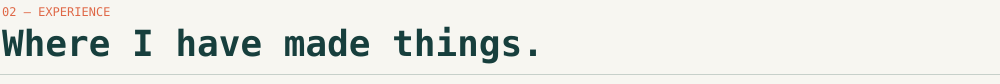
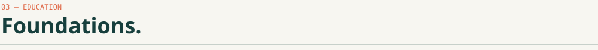
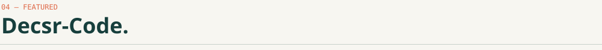
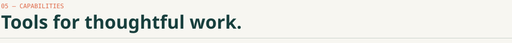
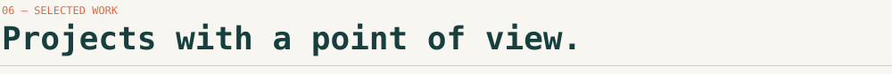
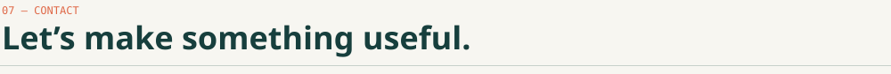

Software Engineer at Greystone Data Systems Vietnam · system integration, backend and developer tooling

## 

- Software Engineer in HCM City, Viet Nam, with experience in software development and system integration.
- Builds industrial machine software and MQTT-based communication between machines, firmware and web systems.
- Backend background in C#, Java and RESTful APIs; builds developer tooling in Go, as in Decsr-Code.
- Adaptable and eager to learn. English (good conversational proficiency) and Vietnamese (native).

## 

**Software Engineer** · Greystone Data Systems Vietnam · *May 2025 – Present*

- Designed and implemented MQTT (Mosquitto) communication across 8 topics, connecting 4 industrial machines for real-time dashboards, central logs and remote control.
- Built Qt user interfaces for machine control software and wrote specifications and documentation for software, hardware and web components.
- Worked with hardware and assembly teams on integration and commissioning; builds with CMake, Git and GitLab on Linux.

**Backend Developer** · FPT Software · *Apr 2024 – Apr 2025*

- Offshore team serving Japanese clients; contributed backend features and RESTful APIs.
- Took part in module design, deployment and environment configuration.
- Maintained delivered systems, resolving issues from customer feedback.

## 

**FPT University** · Bachelor's Degree in Software Engineering · *2021 – 2026, graduated*

Achievements: Third Prize, Provincial Informatics Competition (2021) · Consolation Prize, North Central Delta Olympic Competition (2020)

## 

- A team of specialist agents (PM, Coder, QA, UX Reviewer, Security) with human approval gates.
- Test-driven, resumable runs with a rich terminal UI.
- Works with CLI runners and local models (Ollama, LM Studio, MLX).

[Repository](https://github.com/Decsr/Decsr-Code) · [Releases](https://github.com/Decsr/Decsr-Code/releases) · latest v0.1.1

## 

<table>
<tr>
<td><b>Languages</b></td>
<td>

</td>
</tr>
<tr>
<td><b>Backend</b></td>
<td>

</td>
</tr>
<tr>
<td><b>Systems &amp; integration</b></td>
<td>

</td>
</tr>
<tr>
<td><b>Databases</b></td>
<td>

</td>
</tr>
<tr>
<td><b>Tools &amp; DevOps</b></td>
<td>

</td>
</tr>
</table>

## 

<table>
<tr>
<td width="50%" valign="top">

**[CV](https://github.com/Decsr/CV)** · [live site](https://decsr.github.io/CV/) 
Static CV and photography portfolio site. 
HTML / CSS / JavaScript

</td>
<td width="50%" valign="top">

**[2048-Unity](https://github.com/Decsr/2048-Unity)** 
2048 puzzle game in Unity. 
C# · Unity

</td>
</tr>
<tr>
<td width="50%" valign="top">

**[Personal-Project](https://github.com/Decsr/Personal-Project)** 
Tetris for Windows desktop. 
C# · WPF

</td>
<td width="50%" valign="top">

**[Codeforces](https://github.com/Decsr/Codeforces)** 
Competitive programming solutions. 
C++

</td>
</tr>
</table>

## 

Open to collaboration — reach me at [truongnguyenhoanglong@gmail.com](mailto:truongnguyenhoanglong@gmail.com) or on [LinkedIn](https://www.linkedin.com/in/decsr/)

✦ thanks for visiting ✦

