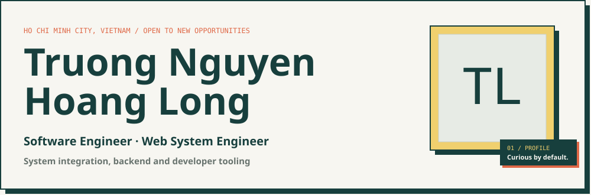
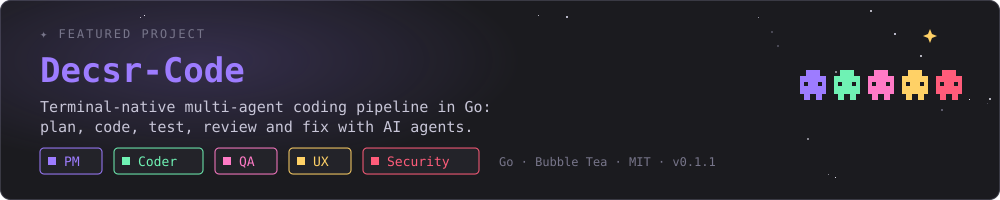

## ✦ About

- Software developer based in HCM City, Viet Nam.
- Builds terminal-native developer tools in Go.
- Also works with C# / .NET (WPF), Java, C++ and the web.
- Game projects in Unity.

## ✦ Featured

- A team of specialist agents (PM, Coder, QA, UX Reviewer, Security) with human approval gates.
- Test-driven, resumable runs with a rich terminal UI.
- Works with CLI runners and local models (Ollama, LM Studio, MLX).
- Released with CI and an MIT license: [Repository](https://github.com/Decsr/Decsr-Code) · [Releases](https://github.com/Decsr/Decsr-Code/releases) (latest v0.1.1).

## ✦ Tech stack

## ✦ Projects

<table>
<tr>
<td width="50%" valign="top">

**[CV](https://github.com/Decsr/CV)** · [live site](https://decsr.github.io/CV/) 
Static CV and photography portfolio site. 
HTML / CSS / JavaScript

</td>
<td width="50%" valign="top">

**[2048-Unity](https://github.com/Decsr/2048-Unity)** 
2048 puzzle game in Unity. 
C# · Unity

</td>
</tr>
<tr>
<td width="50%" valign="top">

**[Personal-Project](https://github.com/Decsr/Personal-Project)** 
Tetris for Windows desktop. 
C# · WPF

</td>
<td width="50%" valign="top">

**[FPT](https://github.com/Decsr/FPT)** 
University semester projects: a pizza store and a koi fish veterinary centre. 
Java · JavaScript · C# · SQL

</td>
</tr>
<tr>
<td width="50%" valign="top">

**[Codeforces](https://github.com/Decsr/Codeforces)** 
Competitive programming solutions. 
C++

</td>
<td width="50%" valign="top">

**Older exercises** 
Assorted algorithm exercise repositories. 
see my repositories

</td>
</tr>
</table>

✦ thanks for visiting ✦

